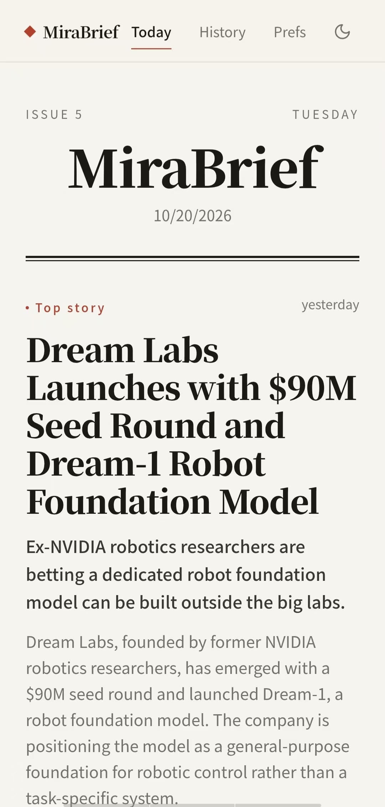
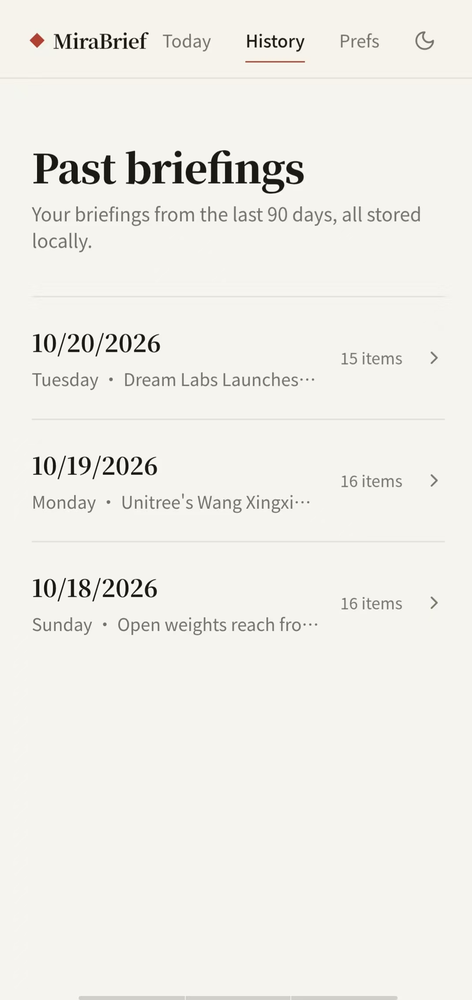
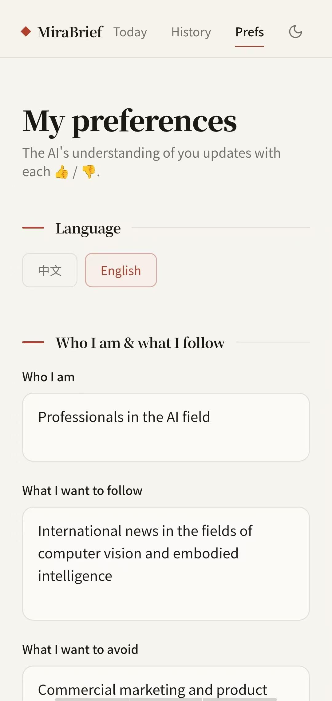

# MiraBrief

### Your news. Your interests. One personal AI newspaper.

MiraBrief is an AI-powered personalized news app that helps you spend less time searching and more time discovering stories that matter to you.

🌐 **Website:** https://mirabrief.com

## Why MiraBrief?

Every day, thousands of headlines compete for your attention. Finding the stories that matter to you shouldn't mean endless scrolling or repeated searches.

MiraBrief helps you explore a more personal way to stay informed through AI-assisted news discovery, content filtering, and concise summaries.

## Features

- 📰 **Personalized News** — Explore stories based on your interests.
- 🤖 **AI-Assisted Curation** — Discover relevant stories from supported sources.
- ✨ **Concise Summaries** — Get the key points in a newspaper-inspired reading experience.
- 🎯 **Personal Preferences** — Tell MiraBrief which topics interest you and which you prefer to avoid.
- 📚 **Briefing History** — Revisit previous editions.
- 👍 **Feedback** — Help shape a more relevant news experience through your preferences and feedback.

## Screenshots

  
  
  

## Download

Visit our official website to find the latest Android version:

**https://mirabrief.com**

## Project Status

MiraBrief is an independent project in its early release stage. We are continuing to improve the product based on real-world use and feedback.

## Feedback

Have a suggestion or found a problem? Please use the Issues section of this repository to share your feedback.

## Security

Please do not post API keys, device tokens, private logs, or other sensitive information in public issues.

---

**MiraBrief — Less noise. More of what matters.**
